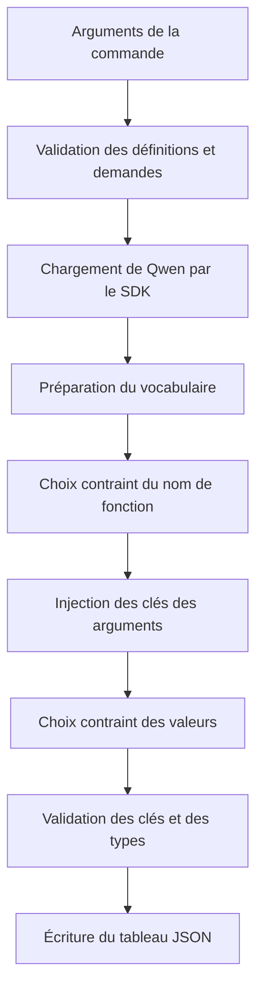

# Call Me Maybe — comprendre le projet et ses corrections

Bilan des vérifications : **22 tests réussis**, `make lint` et `make lint-strict` réussis sur les 13 fichiers Python. Avec Qwen, les 11 questions fournies ont été traitées en 57,9 secondes de pipeline : 11 sorties conformes au schéma et 10 appels entièrement corrects, soit 90,91 %. Le cas restant et la méthode de mesure sont détaillés en section 13.

Document en français pour **eolivier**. Les commentaires et docstrings du code restent en anglais, comme demandé. Ce guide accompagne le sujet version 1.7 fourni dans le dépôt.

## 1. Ce que le programme doit faire

Pour la question :

```text
What is the sum of 2 and 3?
```

le programme doit construire :

```json
{
  "prompt": "What is the sum of 2 and 3?",
  "name": "fn_add_numbers",
  "parameters": {"a": 2.0, "b": 3.0}
}
```

Il ne doit pas calculer `5`. Son travail consiste à sélectionner un outil et à préparer ses arguments. L’exécution réelle de l’outil ne fait pas partie de ce projet.

Trois propriétés différentes doivent être distinguées :

1. **Syntaxe** : peut-on relire le fichier avec un parseur JSON ?
2. **Schéma** : retrouve-t-on exactement les bons champs et les bons types ?
3. **Sens** : a-t-on choisi la bonne fonction et extrait les bonnes valeurs ?

Exemple : `{"a": 7.0, "b": 9.0}` possède les bons types pour une addition, mais ce sont de mauvais arguments pour la question « 2 et 3 ». Le décodage contraint sécurise la structure ; il ne rend pas le modèle infaillible sur le sens.

## 2. Vue d’ensemble des fichiers

| Fichier ou dossier | Rôle |
|---|---|
| `src/__init__.py` | Déclare le paquet de l’application. |
| `src/__main__.py` | Lance le programme, gère les chemins et assemble le pipeline. |
| `src/parser.py` | Valide les entrées et les appels produits avec Pydantic. |
| `src/function_select.py` | Fait choisir une fonction au LLM parmi les noms autorisés. |
| `src/fn_add_nb.py` | Génère les arguments selon leur grammaire JSON ; son ancien nom a été conservé. |
| `data/input/functions_definition.json` | Décrit les fonctions disponibles et leurs arguments. |
| `data/input/function_calling_tests.json` | Contient les demandes à traiter, dans leur ordre. |
| `data/output/function_calls.json` | Résultat généré par défaut ; ne doit pas être versionné. |
| `llm_sdk/llm_sdk/__init__.py` | Charge le modèle et expose ses méthodes publiques. |
| `llm_sdk/pyproject.toml` | Dépendances du SDK fourni. |
| `llm_sdk/uv.lock` | Ancien verrou propre au sous-projet SDK ; le lancement du projet utilise le verrou racine. |
| `pyproject.toml` | Dépendances de l’application et lien vers le SDK local. |
| `uv.lock` | Versions et distributions résolues pour installer le projet. |
| `makefile` | Commandes de lancement, contrôle, tests et nettoyage. |
| `.flake8` | Exclut les environnements et caches de l’analyse Flake8. |
| `.gitignore` | Empêche Git d’ajouter les caches, environnements et résultats générés. |
| `test/test_validation.py` | Tests des schémas d’entrée et des appels de sortie. |
| `test/test_decoding.py` | Tests des grammaires et de la sélection contrainte. |
| `test/test_cli.py` | Tests des fichiers, des erreurs et du programme en ligne de commande. |
| `test/test.py`, `test/tests.py`, `test/testz.py` | Expériences manuelles historiques sur le SDK. |
| `README.md` | Présentation en anglais exigée par le sujet, au nom de `eolivier`. |
| `doc.md` | Le présent guide en français. |
| `en.subject.pdf` | Sujet de référence. |

Les dossiers `.git`, `.venv`, `__pycache__` et `.mypy_cache` servent aux outils et à l’environnement. Ils ne constituent pas le fonctionnement métier du projet.

## 3. Le trajet complet d’une question



Pour une série de demandes, le modèle et le vocabulaire sont chargés une seule fois. La sélection et l’extraction sont ensuite répétées pour chaque demande. L’ordre des résultats correspond à l’ordre des questions d’entrée.

## 4. `src/parser.py` — modèles et validation

### 4.1 Les alias `ParameterType` et `ParameterValue`

`ParameterType` n’est pas une fonction : c’est la liste des types pris en charge dans le schéma, soit `number`, `string` et `boolean`.

`ParameterValue` décrit les valeurs manipulées dans le programme : chaînes Python, nombres flottants et booléens.

Cette distinction est utile : le texte `"number"` décrit un type dans la définition ; la valeur `2.0` est un argument réel de ce type.

### 4.2 Classe `InputDetail`

Elle décrit un argument obligatoire :

```json
{"type": "number"}
```

Elle hérite de `BaseModel`, donc Pydantic vérifie les champs lors de sa création.

- `extra='forbid'` interdit les champs inattendus.
- `strict=True` empêche les conversions implicites de types.
- Le champ `type` utilise `ParameterType`, donc `"numbre"` est refusé immédiatement.

Avant, `type: str` acceptait n’importe quel texte. Le programme pouvait ensuite traiter un type mal orthographié comme une chaîne à cause d’un `else` trop large.

### 4.3 Classe `OutputDetail`

Elle hérite de `InputDetail` et valide le type de retour déclaré par une fonction. Elle ne représente pas le résultat d’une exécution : le projet n’exécute pas les fonctions.

L’héritage évite de dupliquer les mêmes règles de validation des types scalaires.

### 4.4 Classe `FonctionDefinition`

Elle représente une fonction complète, avec :

- `name` : un nom non vide ;
- `description` : son rôle, présenté au modèle ;
- `parameters` : dictionnaire des arguments et de leurs types ;
- `returns` : type de retour annoncé.

Le dictionnaire vide `{}` est permis pour une fonction sans argument. En revanche, le champ `parameters` doit bien être présent dans sa définition.

Le nom français de la classe a été conservé pour éviter un renommage inutile de l’interface existante.

### 4.5 Classe `PrompTest`

Elle contient exactement un champ `prompt`, de type chaîne. Le texte original est conservé pour être recopié dans la sortie.

Une chaîne vide est acceptée comme cas limite. Un nombre donné à la place du texte est rejeté, sans conversion automatique en chaîne.

### 4.6 Classe `FunctionCallResult`

Elle représente les trois champs de sortie exigés : `prompt`, `name` et `parameters`.

**Attention : cette classe seule ne connaît pas la définition de la fonction choisie.** C’est pourquoi le programme doit passer par `validate_call()` avant de créer le résultat final. Une union de types scalaires ne suffit pas à vérifier que l’argument `a` est précisément un nombre pour telle fonction.

### 4.7 Fonction `load_json_list(path_json)`

**Entrée :** chemin d’un fichier, sous forme de chaîne ou de `Path`.

**Sortie :** tableau Python dont les éléments ne sont pas encore validés par les modèles métier.

Étapes :

1. transformer le chemin en objet `Path` ;
2. ouvrir le fichier en UTF-8 avec `with`, pour garantir sa fermeture ;
3. lire son JSON ;
4. transformer les erreurs de lecture, de décodage ou de syntaxe en message contenant le chemin ;
5. vérifier que la racine du JSON est un tableau.

Un fichier contenant `{}` est un JSON syntaxiquement valide, mais ce n’est pas le format d’entrée attendu. Il doit donc être refusé.

Le `Any` de cette fonction est volontaire : juste après `json.load()`, les éléments peuvent encore avoir n’importe quelle forme. Pydantic effectue ensuite la validation précise.

### 4.8 Fonction `validation_function(path_json)`

**Entrée :** chemin des définitions de fonctions.

**Sortie :** liste de `FonctionDefinition` validées.

Elle utilise `load_json_list()`, puis valide chaque élément avec `FonctionDefinition.model_validate()`.

Deux contrôles supplémentaires sont nécessaires :

- une liste vide ne permettrait aucun choix de fonction ;
- deux fonctions portant le même nom rendraient le dispatch ambigu et s’écraseraient dans un dictionnaire indexé par nom.

La fonction rejette ces deux cas avant le chargement du modèle, ce qui évite de charger des poids lourds pour une entrée déjà inutilisable.

### 4.9 Fonction `load_prompts(path_json)`

**Entrée :** chemin du tableau des demandes.

**Sortie :** liste de `PrompTest` dans l’ordre initial.

La lecture du fichier est partagée avec `load_json_list()`. Chaque élément est ensuite validé avec Pydantic.

La liste vide est permise : elle signifie qu’il n’y a aucune question à traiter. Le programme écrira alors `[]` sans charger le modèle.

### 4.10 Fonction `validate_call(prompt, definition, parameters)`

**Entrées :** demande originale, fonction sélectionnée et valeurs extraites.

**Sortie :** un `FunctionCallResult` prêt à être sérialisé.

Cette fonction constitue le contrôle final du schéma :

1. comparer exactement les clés obtenues aux clés de `definition.parameters` ;
2. vérifier chaque valeur selon le type déclaré ;
3. refuser les nombres infinis et `NaN` ;
4. construire seulement ensuite le modèle de sortie.

Exemples :

| Valeur pour un argument `number` | Résultat |
|---|---|
| `2.0` | Acceptée. |
| `"2"` | Refusée : c’est du texte. |
| `True` | Refusée : c’est un booléen. |
| `float('inf')` | Refusée : non fini. |
| `float('nan')` | Refusée : non fini. |

Pourquoi exclure explicitement les booléens ? En Python, `bool` hérite de `int`. Un simple `isinstance(True, int)` vaut donc `True`, alors que le schéma JSON distingue les deux types.

Le paramètre utilise `Mapping` : la fonction a besoin de lire les valeurs, pas de modifier le dictionnaire transmis. Une copie `dict(parameters)` est créée pour le modèle final.

## 5. `src/function_select.py` — choisir la fonction

### 5.1 Fonction `select_valid_function(prompt, functions, model)`

**Entrées :** demande utilisateur, définitions disponibles et modèle SDK.

**Sortie :** couple `(nom_choisi, contexte_en_tokens)`.

Elle ne cherche pas des mots-clés dans la demande pour décider du nom. Le choix dépend des scores du LLM.

#### Étape A — construire le contexte

Le message système présente les définitions et demande de produire un appel JSON. Il précise de copier les arguments de la question et de ne pas exécuter les fonctions.

Le contexte contient ensuite la demande utilisateur, puis le début de réponse :

```text
{"name":
```

Les marqueurs de conversation correspondent au format de Qwen. Le SDK transforme ce texte en identifiants de tokens.

#### Étape B — préparer les branches autorisées

Chaque nom est d’abord transformé en chaîne JSON complète par `json.dumps()`, puis tokenisé.

Exemple conceptuel :

```text
"fn"
"fn_long"
```

Les guillemets font partie des branches. C’est la correction qui permet au nom court de se terminer sans être forcé à continuer vers le nom long.

Le nombre réel de tokens n’est pas le nombre de caractères. Le tokenizer peut regrouper plusieurs caractères dans un seul token.

#### Étape C — filtrer les branches à chaque tour

`generated` contient le préfixe déjà choisi. Le programme conserve uniquement les noms dont la séquence de tokens commence par ce préfixe.

- Si une séquence complète correspond au préfixe, la fonction est sélectionnée.
- Sinon, les tokens suivants possibles de toutes les branches restantes sont autorisés.
- `choose_token()` fait choisir au modèle le meilleur token parmi eux.
- Ce token est ajouté à la fois à `generated` et au contexte.

Le contexte retourné inclut le guillemet final du nom. Le programme principal ajoute donc `, "parameters": {` sans rajouter un deuxième guillemet.

## 6. `src/fn_add_nb.py` — grammaires et arguments

Ce fichier ne sert plus uniquement à l’addition. Il gère tous les arguments scalaires. Son nom historique a été conservé ; il ne contient pas une solution codée en dur pour `fn_add_numbers`.

### 6.1 Classe `TokenVocabulary`

C’est un cache validé par Pydantic, contenant :

- `pieces` : pour chaque identifiant de token, les octets qu’il représente ;
- `ordinary` : tokens formant du texte UTF-8 simple, sans guillemet, antislash ou contrôle brut ;
- `special` : tokens demandant une vérification plus précise pour les chaînes ;
- `numeric` : tokens dont les caractères pourraient appartenir à un nombre.

Le mot `special` désigne ici des candidats à contrôler attentivement. Les marqueurs de conversation comme `<|im_end|>` sont exclus de la génération des valeurs.

### 6.2 Fonction `build_vocabulary(vocab)`

**Entrée :** dictionnaire public chargé depuis le fichier de vocabulaire du SDK.

**Sortie :** un `TokenVocabulary` réutilisable pour toutes les questions.

Qwen utilise une représentation de vocabulaire dite ByteLevel : certains caractères visibles représentent des octets qui ne sont pas affichés tels quels. Par exemple, `Ġ` représente habituellement un espace. Retirer simplement ce symbole ferait perdre des espaces significatifs.

La fonction reconstruit la correspondance entre les 256 octets possibles et les symboles du vocabulaire. Elle transforme ensuite chaque token en octets et le classe dans les groupes utiles.

La séparation en groupes évite de refaire la même analyse pour tous les tokens, à chaque valeur. Le fichier fourni par le SDK est utilisé ; aucun attribut privé du SDK n’est consulté.

**Limite assumée :** cette conversion vise le tokenizer ByteLevel de Qwen. Un modèle utilisant une autre représentation doit être adapté explicitement.

### 6.3 Fonction `number_state(data)`

**Entrée :** octets d’un nombre en cours de construction.

**Sortie :** deux booléens `(préfixe_valide, nombre_complet)`.

La fonction parcourt le texte en gardant un état. Chaque caractère doit permettre une transition légale :

| État | Ce qui peut venir ensuite |
|---|---|
| Début | `-` ou un chiffre. |
| Signe | Un chiffre. |
| Zéro initial | Un point ou un exposant ; pas un deuxième chiffre entier. |
| Partie entière | Des chiffres, un point ou un exposant. |
| Point | Au moins un chiffre. |
| Fraction | Des chiffres ou un exposant. |
| Marqueur d’exposant | Un signe facultatif ou un chiffre. |
| Signe d’exposant | Un chiffre. |
| Chiffres d’exposant | D’autres chiffres ou la fin du nombre. |

Un préfixe valide n’est pas toujours un nombre complet :

| Texte | Préfixe valide ? | Complet ? |
|---|---|---|
| `-` | Oui | Non |
| `1.` | Oui | Non |
| `1e-` | Oui | Non |
| `-2.5e3` | Oui | Oui |
| `01` | Non | Non |
| `--2` | Non | Non |
| `1.2.3` | Non | Non |

La virgule ou l’accolade de fin ne devient autorisée que lorsque le nombre est complet. Cela évite qu’un argument numérique se termine après un simple `-`.

Cette grammaire remplace l’ancienne liste de caractères autorisés, qui ne vérifiait pas leur ordre.

### 6.4 Fonction `string_state(data)`

**Entrée :** octets d’une chaîne JSON, avec son guillemet initial.

**Sortie :** `(préfixe_valide, chaîne_complète)`.

Elle suit deux informations essentielles :

- un antislash a-t-il ouvert une séquence d’échappement ?
- combien de chiffres hexadécimaux restent-ils à lire après `\u` ?

Un guillemet termine la chaîne seulement s’il n’est pas échappé. Un retour à la ligne brut est interdit à l’intérieur d’une chaîne JSON ; la séquence de caractères `\n` est permise.

```text
"Bonjour \"ami\""   → contient des guillemets dans la valeur
"ligne\nsuivante"   → contient un retour à la ligne après décodage JSON
"\u0041"           → devient A
```

Une séquence UTF-8 peut être répartie sur plusieurs tokens. Le contrôle du préfixe accepte donc une séquence incomplète si les octets suivants peuvent encore la compléter. À la fermeture, `json.loads()` vérifie la chaîne complète et son encodage.

Aucun `.strip()` n’est appliqué. Les espaces avant et après le texte appartiennent à la valeur et doivent être conservés.

### 6.5 Fonction `primitive_state(data, kind)`

Elle choisit la grammaire selon `kind` :

- `number` : `number_state()`, puis contrôle de finitude si le nombre est complet ;
- `string` : `string_state()` ;
- `boolean` : le préfixe doit appartenir à `true` ou `false`.

Les booléens JSON s’écrivent en minuscules. `True` est une écriture Python, pas un littéral JSON valide.

Un nombre comme `1e309` possède une syntaxe numérique, mais dépasse la représentation flottante finie utilisée ici : il est refusé comme candidat complet.

### 6.6 Fonction `choose_token(current_ids, allowed, model)`

**Entrées :** contexte complet, identifiants autorisés et modèle.

**Sortie :** identifiant du meilleur token compatible avec la grammaire.

Le SDK renvoie un logit par token du vocabulaire. Un logit est un score, pas nécessairement une probabilité entre 0 et 1.

La fonction :

1. récupère les scores du modèle ;
2. déduplique et trie les identifiants autorisés ;
3. vérifie qu’ils correspondent bien à des positions du tableau de scores ;
4. transforme les scores non finis en `-inf` ;
5. choisit l’argument du maximum parmi les candidats valides.

Exemple :

| Token | Score | Autorisé ? |
|---|---:|---|
| Lettre `a` | 12 | Non |
| Chiffre `2` | 8 | Oui |
| Chiffre `3` | 6 | Oui |

Le résultat est `2`. Le modèle préférerait globalement `a`, mais la grammaire l’interdit.

Choisir uniquement parmi les indices autorisés est équivalent, pour cette sélection gloutonne, à remplacer tous les autres scores par `-inf` dans un masque de taille vocabulaire.

Si aucun candidat valide ne possède de score fini, la fonction lève une erreur claire au lieu de sélectionner arbitrairement le token zéro.

### 6.7 Fonction `string_completion(data, suffix)`

Cette fonction corrige une frontière importante entre les tokens et les champs JSON.

Un token n’est pas forcément un morceau de texte situé entièrement à l’intérieur d’une valeur. Il peut contenir à la fois :

```text
hello",
```

Cela signifie « fin de la valeur `hello`, fermeture de la chaîne, puis virgule ».

L’ancien code arrêtait la génération dès qu’un token contenait un guillemet et perdait le texte qui le précédait. La première correction, trop restrictive, refusait les tokens contenant de la ponctuation après le guillemet. Le test avec Qwen a montré que cette restriction pouvait bloquer la fin d’une chaîne.

`string_completion()` :

1. cherche une fermeture de chaîne valide ;
2. sépare le littéral complet et les octets situés après sa fermeture ;
3. vérifie que ces octets correspondent exactement au début de la ponctuation et de la prochaine clé prévues par le schéma ;
4. renvoie le littéral et la partie de structure qu’il reste à injecter.

Deux présentations sont autorisées entre les arguments : une avec espace après la virgule, une sans. Le modèle ne peut pas ajouter une autre clé arbitraire : le suffixe attendu vient de la définition de fonction.

### 6.8 Fonction `decode_parameter(...)`

**Entrées :** contexte modifiable, type voulu, cache de vocabulaire, modèle, suffixe attendu et limite de tokens.

**Sortie :** une valeur Python du bon type.

#### Préparation

Pour une chaîne, le programme injecte le guillemet initial : cette ponctuation est imposée par le schéma, elle n’a pas besoin d’être devinée.

Pour les nombres, le décodeur prépare le séparateur qui permettra de terminer une valeur complète. Il attend que ce caractère de ponctuation corresponde à un seul token, comme dans Qwen.

#### Boucle de génération

À chaque tour :

1. vérifier le préfixe actuel ;
2. établir les tokens pouvant le prolonger légalement ;
3. autoriser la fin d’un nombre seulement si celui-ci est complet ;
4. faire choisir le token avec `choose_token()` ;
5. ajouter le token choisi au contexte ;
6. si le littéral est terminé, le convertir et compléter uniquement la structure manquante.

Les chaînes ordinaires utilisent un groupe de candidats précalculé lorsque le contexte n’est pas au milieu d’un échappement ou d’une séquence UTF-8. Les tokens particuliers sont analysés plus finement.

Pour les tokens fusionnant texte, guillemet et séparateur, la fonction utilise `string_completion()` : elle conserve le vrai token choisi et n’injecte ensuite que le suffixe restant. Elle ne duplique donc pas la virgule.

#### Limite de génération

La limite actuelle est de 256 tokens par valeur. Si la valeur ne peut pas se terminer à temps, une erreur est produite. Le programme ne prétend pas qu’un texte coupé est un argument complet.

Pour un nombre, atteindre la limite sans avoir choisi de séparateur provoque aussi une erreur. Un préfixe complet ne prouve pas que le modèle avait fini ce nombre.

### 6.9 Fonction `parse_scalar(data, kind)`

Elle transforme un littéral JSON complet en valeur Python avec `json.loads()`.

- `number` devient un `float`, vérifié fini avec `math.isfinite()` ;
- `boolean` devient un vrai `bool` ;
- `string` devient une vraie chaîne, avec ses échappements décodés.

L’ancienne conversion retournait parfois `0.0` lorsque le texte était invalide. Cette valeur de secours silencieuse a été supprimée : elle pouvait masquer un échec d’extraction.

Attention aux limites des flottants : tous les très grands entiers ne sont pas représentables exactement dans un `float`. C’est une limite numérique réelle, distincte de la validité syntaxique du JSON.

### 6.10 Fonction `extract_all_parameters(...)`

**Entrées :** définition choisie, contexte contenant l’accolade d’ouverture des paramètres, vocabulaire et modèle.

**Sortie :** dictionnaire contenant tous les arguments déclarés.

La fonction injecte d’abord la première clé. Pour chaque valeur, elle calcule le suffixe qui doit suivre :

```text
, "prochain_argument":
```

ou l’accolade finale `}` si c’est le dernier argument.

Elle appelle ensuite `decode_parameter()` pour le type de l’argument. Le décodeur génère la valeur et complète ce suffixe ; le prochain tour commence donc déjà après la clé suivante.

Une fonction sans paramètre produit `{}` : aucune valeur n’est inventée.

La fonction ne reconnaît pas les noms `a`, `b`, `s` ou `name` en dur. Elle utilise les noms et types du fichier de définitions, ce qui permet de changer les fonctions lors de l’évaluation.

## 7. `src/__main__.py` — exécution et fichiers

### 7.1 Fonction `parse_args()`

Elle utilise `argparse` pour lire :

| Option | Valeur par défaut |
|---|---|
| `--functions_definition` | `data/input/functions_definition.json` |
| `--input` | `data/input/function_calling_tests.json` |
| `--output` | `data/output/function_calls.json` |

Elle renvoie un `Namespace` contenant ces trois chemins. `--help` affiche les options et leurs descriptions.

### 7.2 Fonction `write_results(path, results)`

**Entrées :** chemin de sortie et liste complète des appels validés.

Elle crée le dossier parent s’il n’existe pas. Elle écrit ensuite dans un fichier temporaire situé dans le même dossier que la destination.

`json.dump()` est configuré avec :

- `indent=2`, pour une sortie lisible ;
- `ensure_ascii=False`, pour écrire les caractères Unicode normalement ;
- `allow_nan=False`, pour refuser `NaN` et les infinis, que Python peut sinon sérialiser malgré leur non-conformité au JSON standard.

Quand l’écriture réussit, le temporaire remplace la destination. C’est une écriture atomique dans le même système de fichiers : un échec de sérialisation ne détruit pas le précédent résultat.

Le bloc `finally` supprime un éventuel temporaire restant. Il ne supprime pas le résultat précédent lorsque l’écriture échoue.

### 7.3 Fonction `main()`

Elle orchestre le programme :

1. lire les arguments ;
2. interdire une sortie qui écraserait l’un des fichiers d’entrée ;
3. démarrer le chronomètre ;
4. charger et valider les définitions ;
5. charger et valider les demandes ;
6. écrire `[]` immédiatement si les demandes sont vides ;
7. charger le modèle une fois ;
8. lire son vocabulaire public et le préparer ;
9. sélectionner une fonction pour chaque demande ;
10. injecter la structure de l’objet `parameters` ;
11. extraire les valeurs ;
12. valider les clés et les types ;
13. ajouter l’appel à la liste ;
14. écrire le fichier complet quand toutes les demandes ont réussi.

Les messages de progression vont sur `stderr`. Ils ne deviennent pas du texte parasite dans le fichier JSON.

Une exception est interceptée au niveau principal, affichée sous forme de message `Error: ...`, puis le programme sort avec un code non nul. Il ne masque pas une erreur en écrivant un faux appel.

**Conséquence volontaire :** si une demande échoue, le lot n’est pas annoncé comme réussi et aucun nouveau résultat partiel ne remplace la destination.

### 7.4 Le bloc `if __name__ == '__main__'`

Il appelle `main()` lorsque le module est exécuté avec `python -m src`. Il évite un lancement automatique lorsque ce fichier est importé pour tester `write_results()`.

## 8. Le SDK, méthode par méthode

Le SDK est le composant fourni qui contient Torch, Transformers et l’accès au cache de modèles. L’application `src` n’importe pas ces bibliothèques directement et ne consulte pas les attributs privés du SDK.

La classe d’origine `Small_LLM_Model` reste le wrapper fourni. Les modèles métier ajoutés à l’application utilisent Pydantic.

### 8.1 `Small_LLM_Model.__init__(...)`

Paramètres importants :

- `model_name` : `Qwen/Qwen3-0.6B` par défaut ;
- `device` : périphérique explicitement demandé, sinon sélection automatique ;
- `dtype` : précision numérique, déterminée par le périphérique par défaut ;
- `trust_remote_code` : option conservée de l’interface fournie.

Le SDK choisit MPS si disponible, sinon CUDA, sinon CPU. Il charge le tokenizer et les poids, choisit un token de remplissage si nécessaire, déplace le modèle sur le périphérique et active le mode évaluation.

Les gradients sont désactivés sur les paramètres : le projet réalise de l’inférence, pas de l’entraînement.

Deux champs internes préparent le cache d’inférence : les identifiants déjà calculés et les clés/valeurs d’attention correspondantes. Ils restent internes au SDK.

Des annotations et conversions `cast` corrigent le décalage entre les types annoncés par les décorateurs de Transformers et leurs méthodes réellement appelables. `cast` n’effectue pas une conversion des poids : c’est une indication pour l’analyse statique.

### 8.2 `encode(text)`

Elle transforme du texte en identifiants, puis renvoie un tenseur à deux dimensions, de forme conceptuelle :

```text
[[id_1, id_2, id_3]]
```

Le premier niveau représente une série de taille un. C’est pourquoi le code utilise `.tolist()[0]` pour obtenir la simple liste des identifiants.

`add_special_tokens=False` signifie que les marqueurs de conversation sont ajoutés explicitement par le contexte, et non implicitement par cette méthode.

### 8.3 `decode(ids)`

Elle transforme des identifiants en texte. Elle accepte une liste d’identifiants ou un tenseur et ignore les tokens spéciaux à l’affichage.

Dans les anciennes expériences, un identifiant isolé était parfois passé directement. Les appels actifs concernés utilisent maintenant une liste : `decode([token_id])`.

Le décodeur principal des arguments utilise les octets du vocabulaire pour respecter les frontières JSON et UTF-8 ; il ne dépend donc pas d’un décodage isolé pouvant perdre des octets répartis entre tokens.

### 8.4 `get_logits_from_input_ids(input_ids)`

**Entrée :** liste des tokens du contexte.

**Sortie :** liste de scores pour le prochain token, une valeur par identifiant du vocabulaire.

La méthode appelle le modèle sans calcul de gradients et récupère les scores à la dernière position de la séquence.

#### Correction de performance : cache d’attention

Avant, chaque appel recalculait tout le contexte : une question et ses définitions pouvaient représenter des centaines de tokens, répétés à chaque nouvelle valeur générée.

Maintenant :

1. le premier appel calcule le contexte entier ;
2. si le contexte suivant commence exactement par les identifiants déjà calculés et ajoute de nouveaux tokens, le SDK ne calcule que le suffixe ajouté ;
3. les clés/valeurs d’attention précédentes sont transmises au modèle ;
4. si le contexte n’est pas une extension du précédent, le cache est abandonné et le calcul repart du contexte complet.

La comparaison porte sur les identifiants, pas sur le nombre de caractères. Une copie des identifiants est mémorisée pour ne pas dépendre des mutations ultérieures de la liste du programme.

Cette optimisation ne choisit pas les fonctions à la place du modèle. Elle évite de refaire un calcul déjà effectué. L’interface publique reste la même et le code de l’application n’accède pas au cache privé.

### 8.5 `get_path_to_vocab_file()`

Elle obtient le chemin du fichier qui associe les symboles de tokens à leurs identifiants. Elle utilise le cache Hugging Face ou télécharge le fichier si nécessaire.

Le programme principal ouvre ce chemin avec `json.load()` puis appelle `build_vocabulary()`.

### 8.6 `get_path_to_merges_file()`

Elle renvoie le fichier de fusions du tokenizer BPE. Une fusion décrit comment des morceaux de texte peuvent être regroupés en tokens.

Cette méthode reste disponible dans le SDK, mais le pipeline principal n’en a pas besoin : il utilise la méthode publique `encode()` pour tokeniser ses textes.

### 8.7 `get_path_to_tokenizer_file()`

Elle renvoie le fichier de configuration complet du tokenizer. Elle est conservée comme méthode publique du SDK, même si le pipeline principal ne l’appelle pas.

## 9. Les fichiers de données

### `functions_definition.json`

Ce fichier décrit les outils disponibles. Il ne contient pas les implémentations Python à exécuter.

Correction concrète dans `fn_greet` :

```diff
- "typel):e": "string"
+ "type": "string"
```

La faute empêchait Pydantic de trouver le champ obligatoire `type`. Le programme refusait donc les définitions avant même de charger le modèle.

### `function_calling_tests.json`

Il contient 11 questions de démonstration : additions, salutations, chaînes à inverser, racines carrées et remplacements par expressions régulières.

La question de racine carrée doit produire l’argument d’entrée, par exemple `16`, et non sa racine `4`. De même, la question d’inversion demande l’argument `hello`, pas le résultat `olleh`.

### `function_calls.json`

C’est un tableau contenant un objet par question. Chaque objet possède exactement `prompt`, `name` et `parameters`.

Il est généré par le programme et exclu de Git. Les sorties de vérification de cette intervention sont conservées séparément pour ne pas versionner des résultats générés.

## 10. Installation, lint et nettoyage

### `pyproject.toml`

Il rend le projet installable depuis sa racine. Le correcteur peut lancer `uv sync` sans deviner où sont les dépendances.

- `llm-sdk` vient du dossier local `llm_sdk`, en installation éditable ;
- `numpy` sert à manipuler les tableaux de logits ;
- `pydantic` valide les schémas ;
- `flake8` et `mypy` appartiennent au groupe de développement, installé par défaut par `uv sync`.

L’installation du paquet SDK expose son nom normal `llm_sdk`. Les imports de l’application sont donc devenus :

```python
from llm_sdk import Small_LLM_Model
```

L’ancien chemin `llm_sdk.llm_sdk` dépendait de l’arborescence locale non installée. Il provoquait aussi une détection du même fichier sous deux noms par mypy.

### `uv.lock`

Il verrouille les versions résolues, leurs dépendances et les distributions nécessaires selon la plateforme et la version de Python. Il ne faut pas le modifier manuellement comme un fichier de code.

L’environnement local a été synchronisé avec ce nouveau verrou. La résolution initiale a installé les versions compatibles du SDK et de ses dépendances.

### `.flake8`

La limite de ligne reste de 79 caractères. Le fichier exclut `.venv`, les caches et les métadonnées Git. Il n’exclut pas le SDK ni les tests.

Exclure l’environnement virtuel évite de demander à Flake8 de corriger les milliers de fichiers des dépendances installées.

### `makefile`

| Commande | Action |
|---|---|
| `make install` | `uv sync` depuis la racine. |
| `make run` | `uv run python -m src`. |
| `make debug` | Même application sous le débogueur `pdb`. |
| `make lint` | Flake8 sur `.` puis mypy sur `.` avec les options du sujet. |
| `make lint-strict` | Flake8 sur `.` puis `mypy . --strict`. |
| `make test` | Découverte des tests `test_*.py`. |
| `make clean` | Supprime les caches du projet et la sortie générée, en épargnant les environnements et `.git`. |

La commande mypy obligatoire conserve :

```text
--warn-return-any
--warn-unused-ignores
--ignore-missing-imports
--disallow-untyped-defs
--check-untyped-defs
```

L’option `--follow-imports=silent` a été retirée. Le périmètre `src` a été remplacé par `.`. Les problèmes du SDK et des expériences Python ne sont donc plus cachés pour obtenir un résultat vert.

### `.gitignore` et fichiers compilés

Les fichiers `.pyc` sont des résultats de compilation de Python, pas des sources à rendre. Deux caches du SDK étaient déjà suivis par Git : ils ont été retirés de l’index, tout en laissant leurs éventuelles copies locales utilisables.

Cette suppression de suivi est préparée dans l’index Git. Aucun commit ni push n’a été effectué. Les autres modifications qui existaient dans ton dépôt ont été conservées.

## 11. Les tests, fonction par fonction

Les classes de tests héritent de `unittest.TestCase`. Elles servent au lanceur de tests ; ce ne sont pas des classes métier de l’application.

### 11.1 `test/test_validation.py`

La classe `ValidationTests` regroupe :

| Méthode | Ce qu’elle vérifie |
|---|---|
| `definition(kind)` | Prépare une définition indépendante, modifiable selon le type à tester. |
| `test_unknown_parameter_type_is_rejected()` | Un type mal orthographié ne devient pas implicitement une chaîne. |
| `test_extra_schema_fields_are_rejected()` | Les champs inattendus d’une définition sont rejetés. |
| `test_bundled_definitions_load()` | Les cinq définitions fournies sont réellement chargeables. |
| `test_output_requires_exact_keys()` | Un argument manquant ou une clé supplémentaire provoque une erreur. |
| `test_output_types_and_finite_numbers()` | Refuse texte, booléen, infini et NaN pour un argument numérique ; accepte un vrai nombre. |

Les premiers tests ont été exécutés avant les corrections : ils montraient le rejet du fichier fourni et l’absence de contrôles sur les champs supplémentaires et les types inconnus.

### 11.2 `test/test_decoding.py`

`ArrayResult` imite uniquement le résultat public de `.tolist()` pour éviter de charger un modèle dans un test déterministe.

`ScriptedModel` fournit des scores contrôlés. Sa méthode `encode()` utilise le petit vocabulaire du test. Sa méthode `get_logits_from_input_ids()` mémorise le contexte et donne le score maximal au prochain token prévu.

Ces objets de test utilisent Pydantic. Ils ne cherchent pas à reproduire la qualité de Qwen : ils permettent de provoquer précisément une frontière ou un token dangereux.

La classe `DecodingTests` vérifie :

| Méthode | But |
|---|---|
| `test_invalid_number_prefixes()` | Refuser signes répétés, zéros initiaux interdits, double point et exposant mal formé. |
| `test_complete_numbers_and_incomplete_prefixes()` | Distinguer nombre complet et préfixe qui exige encore un chiffre. |
| `test_quotes_and_escapes()` | Accepter Unicode et échappements légaux ; rejeter les séquences invalides. |
| `test_boolean_literals()` | Vérifier la grammaire de `true` et `false`. |
| `test_multi_character_token_before_quote_is_preserved()` | Conserver le texte d’un token contenant aussi son guillemet final. |
| `test_generation_limit_raises()` | Refuser de retourner une chaîne silencieusement tronquée. |
| `test_non_finite_numbers_are_masked()` | Écarter un exposant produisant un infini. |
| `test_prefix_function_name_can_finish()` | Permettre de choisir `fn` même si `fn_long` existe. |
| `test_boolean_generation()` | Générer réellement un booléen en suivant les scores autorisés. |
| `test_quote_and_comma_in_one_token()` | Accepter un token qui ferme une chaîne et émet sa virgule. |
| `test_number_generation_with_exponent()` | Générer un flottant négatif avec décimale et exposant, puis injecter son séparateur. |
| `test_merged_token_can_start_next_argument_key()` | Conserver un token qui contient déjà la virgule et le début de la clé suivante, sans les dupliquer. |

Le dernier test a d’abord échoué, puis a réussi après l’ajout de `string_completion()`.

### 11.3 `test/test_cli.py`

La classe `FileAndCliTests` utilise des dossiers temporaires pour ne pas modifier les données du projet.

| Méthode | But |
|---|---|
| `test_missing_and_malformed_input()` | Tester fichier absent, JSON cassé et mauvaise forme racine. |
| `test_empty_and_duplicate_definitions()` | Refuser un ensemble vide de fonctions et les noms dupliqués. |
| `test_empty_prompts_write_empty_array()` | Lancer la vraie commande avec une entrée vide et vérifier `[]`. |
| `test_failure_preserves_previous_output()` | Vérifier qu’une erreur de sérialisation conserve l’ancien fichier et nettoie le temporaire. |
| `test_cli_errors_are_clear()` | Vérifier un code de sortie non nul et un message sans traceback non géré. |

Ces tests lancent parfois un sous-processus Python, mais pas d’inférence de modèle : leurs entrées provoquent une sortie avant cette étape.

### 11.4 Expériences historiques

`test/test.py` contient `speak_with_llm(prompt)` : lecture de logits et démonstration de masquage d’un token. Les identifiants passés à `decode()` ont été remis sous forme de listes et l’accès à un logit utilise maintenant l’identifiant du caractère obtenu depuis le vocabulaire.

`test/tests.py` contient un autre `speak_with_llm(prompt)` : chargement du vocabulaire et affichage des identifiants de quelques caractères JSON.

`test/testz.py` contient `tchat_llm(prompt)` : boucle de génération libre arrêtée sur les tokens de fin. Ce n’est pas le décodeur contraint de l’application.

Ces trois fichiers ont été conservés, typés et placés derrière un bloc `if __name__ == '__main__'`. Les importer ne lance plus automatiquement une expérience coûteuse. Ils ne constituent pas la suite de régression découverte par `make test`.

## 12. Tableau des corrections : avant et après

| Avant | Maintenant | Pourquoi |
|---|---|---|
| Faute `typel):e` dans les données | Champ `type` corrigé | Le fichier de démonstration doit charger. |
| `type: str` acceptait tous les textes | Types scalaires limités explicitement | Éviter les schémas inconnus. |
| Champs supplémentaires ignorés | `extra='forbid'` | Signaler les fautes au lieu de les masquer. |
| Noms de fonctions dupliqués possibles | Doublons rejetés | Éviter une sélection ambiguë. |
| Filtre numérique par caractères | Grammaire à états | Garantir un ordre syntaxiquement correct. |
| Conversion invalide remplacée par zéro | Erreur explicite | Ne pas inventer un argument. |
| Chaînes coupées dès qu’un token contient `"` | Vérification de la fermeture et des échappements | Préserver le texte avant le guillemet. |
| Ponctuation fusionnée au token refusée | Suffixe de structure vérifié et complété | Permettre les vrais tokens de Qwen. |
| `.strip()` sur les chaînes | Espaces conservés | Ne pas modifier les arguments. |
| Limite pouvant tronquer une valeur | Erreur si la valeur ne se termine pas | Distinguer échec et résultat complet. |
| `Dict[str, Any]` sans contrôle métier | Clés et types validés par fonction | Respecter le schéma réel. |
| JSON Python pouvait accepter NaN/infini | Nombres finis et `allow_nan=False` | Produire un JSON standard. |
| Nom court forcé vers un nom plus long | Branches incluant les guillemets | Gérer les préfixes communs. |
| Imports dépendant du dossier non installé | Import du paquet `llm_sdk` installé | Fonctionner après `uv sync`. |
| Pas de configuration racine | `pyproject.toml` et `uv.lock` | Installation reproductible. |
| Lint limité à `src` et imports silencieux | Analyse de `.` sans cette suppression | Respecter le périmètre du sujet. |
| Scripts manuels exécutés à l’import | Lancement explicite uniquement | Garder des tests utilisables. |
| Réécriture directe du fichier final | Fichier temporaire puis remplacement | Éviter une sortie détruite à mi-écriture. |
| Recalcul du contexte à chaque token | Réutilisation du cache d’attention | Réduire le temps d’inférence. |
| Caches `.pyc` suivis | Retrait du suivi et exclusions | Rendre des sources plutôt que des artefacts locaux. |
| Documentation absente | README anglais et guide français | Préparer usage et compréhension. |

Les anciennes fonctions `get_numeric_token_ids`, `decode_number_parameter`, `decode_string_parameter` et `decode_boolean_parameter` ont été remplacées par le vocabulaire préparé, les grammaires spécialisées et `decode_parameter()`. L’objectif est de partager la même boucle de sélection tout en gardant des règles différentes selon le type.

## 13. Vérification et limites à connaître

Vérifications exécutées après les corrections :

| Vérification | Résultat observé |
|---|---|
| `uv sync --locked` | Réussite ; le verrou et l’environnement sont cohérents. |
| `make test` | 22 tests réussis. |
| `make lint` | Flake8 et mypy réussis sur les 13 fichiers Python. |
| `make lint-strict` | Flake8 et mypy strict réussis sur les 13 fichiers Python. |
| Commande réelle avec Qwen | Code de sortie 0 ; 11 appels produits. |
| Validation indépendante du fichier produit | 11 objets avec les clés attendues et les types conformes aux définitions. |
| Noms de fonctions | 11 bons choix sur 11. |
| Appels complets, arguments inclus | 10 sur 11, soit 90,91 %. |
| Temps du pipeline | 57,9 secondes, y compris le chargement des poids déjà en cache, hors import initial des dépendances. |
| Cache d’inférence | Logits calculés avec cache et après réinitialisation cohérents à la tolérance numérique `1e-4` ; même meilleur token, écart absolu maximal observé `0,00002861`. |

La vérification Qwen a été lancée en mode hors ligne pour utiliser le modèle déjà présent dans le cache. Le programme reste utilisable normalement avec accès au téléchargement lors d’une première installation.

### Résultats des 11 exemples

| Question | Fonction et arguments |
|---|---|
| Addition de 2 et 3 | Corrects : `a=2.0`, `b=3.0`. |
| Addition de 265 et 345 | Corrects : `a=265.0`, `b=345.0`. |
| Saluer shrek | Corrects : `name="shrek"`. |
| Saluer john | Corrects : `name="john"`. |
| Inverser hello | Corrects : argument `s="hello"`. |
| Inverser world | Corrects : argument `s="world"`. |
| Racine de 16 | Corrects : argument `a=16.0`, pas le résultat 4. |
| Racine de 144 | Corrects : argument `a=144.0`, pas le résultat 12. |
| Remplacer les nombres | Corrects : motif `([0-9]+)`, remplacement `NUMBERS`. |
| Remplacer les voyelles | Fonction correcte, texte et motif corrects ; remplacement `**` au lieu de `*`. |
| Remplacer cat par dog | Corrects. |

Pour les expressions régulières, la comparaison accepte des écritures différentes qui donnent le comportement attendu sur la chaîne fournie. Elle vérifie aussi la chaîne source et le texte de remplacement. Elle ne constitue pas une preuve que deux motifs sont équivalents pour toutes les chaînes possibles.

Le remplacement `**` est une erreur sémantique réelle : le JSON reste valide et bien typé, mais chaque voyelle est remplacée par deux astérisques au lieu d’un. Ce cas est donc compté incorrect. Aucune règle spéciale n’a été ajoutée pour remplacer artificiellement cette réponse dans les exemples.

Les seuils de 90 % et de cinq minutes sont atteints sur ce lot local. Ils ne suffisent pas à garantir le résultat sur les données inconnues du correcteur.

Les tests déterministes ne mesurent pas la compréhension du LLM. Le test réel doit contrôler le nom choisi et les arguments, pas uniquement la possibilité de relire le JSON.

Les expressions régulières peuvent avoir plusieurs écritures valides pour la même demande. Il faut alors examiner leur comportement, et pas seulement comparer les caractères des deux motifs.

Le sujet annonce 90 % ou plus de bonnes sélections et extractions, et moins de cinq minutes pour le lot sur une machine standard. Une mesure sur les exemples fournis ne garantit pas le même résultat sur toutes les demandes inconnues.

Limites explicites :

- tokenizer ciblé : Qwen ByteLevel ;
- arguments scalaires seulement ;
- nombres représentés en flottants finis ;
- limite de 256 tokens par argument ;
- une erreur interrompt le lot avec un message, au lieu d’inventer un résultat ;
- premier téléchargement des poids nécessaire si le modèle n’est pas déjà en cache.

## 14. Comment vérifier ta compréhension

Refais le chemin de la question « What is the sum of 2 and 3? » à voix haute :

1. Qui lit le fichier et vérifie sa forme ?
2. Qui connaît les fonctions disponibles ?
3. Quel composant produit les scores ?
4. Pourquoi un token interdit ne peut-il pas être sélectionné ?
5. Qui impose les clés `a` et `b` ?
6. Pourquoi `-` n’autorise-t-il pas encore la fin du nombre ?
7. À quel moment `2` devient-il `2.0` ?
8. Qui vérifie que `True` n’est pas accepté comme nombre ?
9. Pourquoi écrit-on dans un temporaire avant de remplacer la sortie ?
10. Quelle différence reste-t-il entre un appel bien formé et un appel correct ?

Pour expérimenter, change les noms des fonctions et des paramètres dans une copie de leurs définitions, ajoute une fonction sans argument, puis utilise les options de chemins pour lancer le programme sur ces copies. Cela permet de vérifier que l’algorithme dépend bien du schéma fourni.

Commandes à connaître :

```sh
uv sync
uv run python -m src --help
make test
make lint
make lint-strict
uv run python -m src
```

`make debug` permet ensuite de suivre l’exécution dans `pdb`. Des points d’arrêt dans `select_valid_function()`, `decode_parameter()` et `validate_call()` montrent respectivement la sélection, la génération et le contrôle final.
